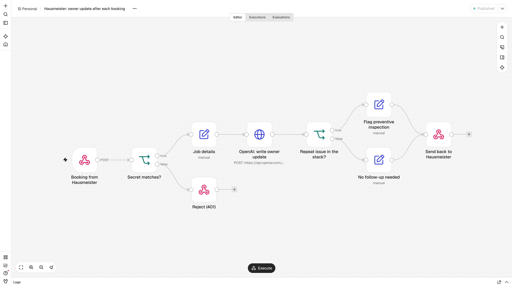
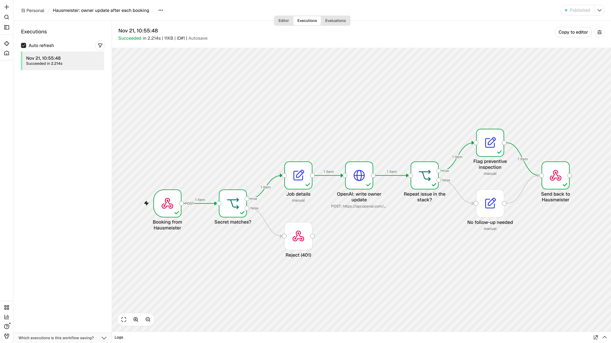

# Partner connector spec

How Hausmeister uses the products of the MAIN AI Hackathon partners, and how it plugs into Reltix's platform for the Reltix track.

| Partner | Product we used | What it does in Hausmeister |
|---|---|---|
| **OpenAI** | `gpt-4.1-mini` | The brain of both voice agents (triage, tool calls, booking) and the live English subtitles on the dashboard |
| **ElevenLabs** | Turbo v2.5 voices | Every word the two agents say: Jessica for the caretaker, Eric for the dispatcher, in English, Dutch or German |
| **n8n** | Workflow automation | After each booking, a workflow writes an update for the property owner and flags repeat issues for a preventive inspection |
| **Reltix** (track) | centrix data model | The context the agent works from: tenant, flat, building, history, contractors. Mocked in Supabase for the demo |

One call, end to end: the tenant phones the caretaker line → **OpenAI** triages and creates the ticket while **ElevenLabs** speaks → the agent phones the plumber → the dispatcher (OpenAI + ElevenLabs again) books a time → the tenant gets an email, and the dashboard shows every step with **OpenAI** subtitles.

---

## OpenAI

### 1. The brain of both voice agents

Both agents run on `gpt-4.1-mini` (temperature 0.3), chosen for fast, reliable tool calling: on a phone call, latency matters more than raw intelligence. The model is configured in [`agents/config.mjs`](../agents/config.mjs) and pushed to Vapi with `node scripts/sync-agents.mjs`; the prompts are in [`agents/tenant/prompt.md`](../agents/tenant/prompt.md) and [`agents/dispatcher/prompt.md`](../agents/dispatcher/prompt.md).

**Caretaker agent (tenant calls in).** The model:
- greets the caller by name (caller ID is matched before it says hello),
- picks the issue type and urgency from at most two triage questions,
- runs the safety script for gas, fire, smoke or sparks ("leave the flat and call 112"), and never books a normal repair for an emergency,
- turns "When are you home today?" answers like "after four" into 24-hour times (`available_from: "16:00"`),
- replies in whatever language the caller speaks.

**Dispatcher agent (calls the contractor).** The model:
- briefs the contractor in three sentences from a brief the backend fills in (flat, problem, urgency, when the tenant is home),
- offers only the free slots it was given, which are already filtered to when the tenant is home,
- recognises the contractor accepting a time and books it,
- switches language the moment the contractor does (it opens in Dutch for Jan and follows him into English).

**Tools the model calls.** Each one is a POST to our webhook (`/api/vapi`), which runs it against the database and returns a short result the agent speaks from. The shapes are fixed in [`src/lib/contract.ts`](../src/lib/contract.ts).

| Agent | Tool | What it does |
|---|---|---|
| Caretaker | `lookup_tenant` | Finds the caller by phone number (only when caller ID didn't match) |
| Caretaker | `create_ticket` | Saves the repair with issue type, urgency and a one-line summary; applies the building pattern rule |
| Caretaker | `dispatch_contractor` | Picks the best-rated contractor of the right trade with a free slot while the tenant is home, and starts the outbound call |
| Dispatcher | `confirm_slot` | Books the accepted slot atomically and emails the tenant |
| Both | `endCall` | Hangs up when the job is done |

The model never invents times, names or prices; every fact it says comes back from a tool.

### 2. Live English subtitles

The plumber call is in Dutch, so the audience can't follow it. Every final transcript line goes through `gpt-4.1-mini` in JSON mode ([`src/lib/openai.ts`](../src/lib/openai.ts)), which detects the language and returns an English translation if the line isn't English. The dashboard shows the original line with the English subtitle under it, live.

### Cost

Measured from the call logs: about **$0.07 per tenant call** and **$0.05–0.09 per dispatcher call**, all-in (model, voice, speech recognition and phone line). The dashboard shows the real cost of each call.

---

## ElevenLabs

Every word the agents say is generated by ElevenLabs, through Vapi's ElevenLabs integration ([`agents/config.mjs`](../agents/config.mjs), `voiceFor`).

| | Caretaker | Dispatcher |
|---|---|---|
| Voice | **Jessica**: warm, calm, for a worried tenant | **Eric**: brisk and friendly, like a good property manager |
| Model | `eleven_turbo_v2_5` | `eleven_turbo_v2_5` |
| Settings | stability 0.4, similarity boost 0.8, speaker boost on | same |

Why these choices:
- **Two distinct voices.** On stage the audience hears two different characters, so it's clear when the caretaker hands over to the dispatcher.
- **Turbo v2.5.** Our first version used a Flash model and sounded robotic on the phone. Turbo v2.5 sounds far more natural and is still fast enough for live turn-taking.
- **Multilingual.** The same voice speaks English, Dutch and German, so the dispatcher can open in Dutch and switch to English mid-call without changing voice.
- **Lower stability (0.4).** More expressive and less monotone; speaker boost keeps it close to the original voice.

---

## n8n

The voice agents handle the call. What should happen *after* a booking (who gets told, what gets logged, what follow-up is needed) is a business process that changes per property manager, so it lives in n8n where the operations team can change it without touching the agent code.

**Workflow: "Hausmeister: owner update after each booking"** ([`n8n/hausmeister-owner-update.json`](../n8n/hausmeister-owner-update.json), import it into any n8n instance)

| # | Node | What it does |
|---|---|---|
| 1 | **Booking from Hausmeister** (Webhook) | Receives every booked job from the app: ticket, flat, stack, issue, urgency, contractor, time, pattern flag, seconds from call to booking |
| 2 | **Secret matches?** (IF) | Checks the `X-Hausmeister-Secret` header; anything else gets **Reject (401)** |
| 3 | **Job details** (Set) | Pulls the fields out of the request |
| 4 | **OpenAI: write owner update** (HTTP Request) | `gpt-4.1-mini` writes a 2–3 sentence update for the property owner: what broke, how urgent, who's booked and when, how fast it was handled |
| 5 | **Repeat issue in the stack?** (IF) | If the pattern rule fired (repeat issue in the same stack within 30 days)… |
| 6 | **Flag preventive inspection** / **No follow-up needed** (Set) | …adds a follow-up: book a preventive inspection of that stack's pipes |
| 7 | **Send back to Hausmeister** (Respond to Webhook) | Returns `owner_update` and `follow_up`; the app logs both on the ticket |

**How the app calls it.** When `confirm_slot` books a job, the app posts the booking to the workflow's webhook ([`src/lib/n8n.ts`](../src/lib/n8n.ts)). It runs with Next.js `after()`, so it starts only once the dispatcher already has its answer and never slows down the call. It's off unless `N8N_WEBHOOK_URL` is set, and a failure in n8n never affects the booking.

**Tested run.** We sent it the booking from a real test call (ticket 1015). Every node succeeded in 2.2 seconds:

> **owner_update:** "There is an urgent water leak next to the lights in unit 3B of Building B. Jan from Schulte Plumbing is booked to fix it today between 12:00 and 14:00, and the issue was handled quickly, with only 48 seconds from call to booking. Since this is a repeat leak in stack B, a preventive inspection is recommended."
>
> **follow_up:** "Book a preventive inspection of the pipes in stack B: repeat leak reports in the last 30 days."

**Status.** Built and tested on n8n running locally. It isn't connected to the live demo, which runs on Vercel and can't reach a local n8n. To go live: import the JSON into n8n Cloud (the hackathon's Cloud Pro licence), replace the `Authorization` header with an n8n OpenAI credential, publish it, and set `N8N_WEBHOOK_URL` (and `N8N_WEBHOOK_SECRET`) on Vercel. Natural next nodes: an email or Slack message to the owner, and a row in a maintenance log sheet.

---

## Reltix (track): plugging into centrix

Reltix's point is that AI isn't the differentiator, context is. Hausmeister only works because it knows who is calling, where they live, what has happened in the building, and who can fix it. Every one of those facts is data Reltix already holds in centrix. For the demo we mocked it in Supabase with the same shape:

| Hausmeister uses | Demo source (Supabase) | centrix equivalent |
|---|---|---|
| Caller by phone number: name, flat, language | `tenants`, `units` | Tenant records |
| Building and its specs | `buildings` | Building specs |
| Repeat issues in the same stack (30-day pattern rule) | `tickets` | Maintenance history |
| Contractors: trade, rating, rate, language | `contractors` | Contractor history |
| Contractor free times | `contractor_slots` | Contractor calendars |
| Who pays for which repair | `lease_rules` (mock) | Lease terms |
| Every step of the job | `tickets`, `ticket_events` | Tickets and tenant interactions |

The contractor is the partner we plugged in, and it follows five steps any partner (internet, energy) could reuse:

1. **Trigger:** the tenant phones the caretaker line.
2. **Context:** tenant, flat, building and history are loaded from the platform.
3. **Contact:** the right contractor is picked and phoned by the AI dispatcher.
4. **Confirm:** the contractor accepts a time and it's booked; a slot can't be booked twice.
5. **Inform:** the tenant gets a confirmation email, and every step is logged on the ticket.

If the contractor doesn't book, the ticket escalates to a human. Emergencies never reach a contractor automatically.

---

## The rest of the stack (not MAIN partners)

| Tool | Role |
|---|---|
| Vapi | Runs the phone calls and the two agents, and sends tool calls to our webhook |
| Deepgram `nova-3` (multilingual, via Vapi) | Speech to text |
| Telnyx | The Dutch +31 phone number, connected to Vapi over SIP |
| Supabase | Postgres database (EU), the mock centrix data and the event log |
| Next.js on Vercel | The webhook, the tools and the live dashboard |
| Gmail | Sends the booking confirmation email to the tenant |
